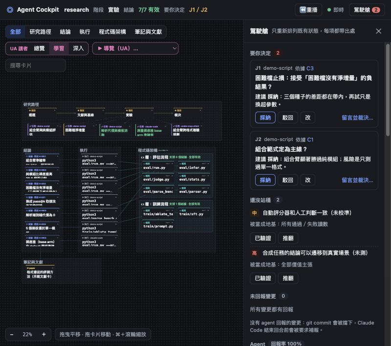
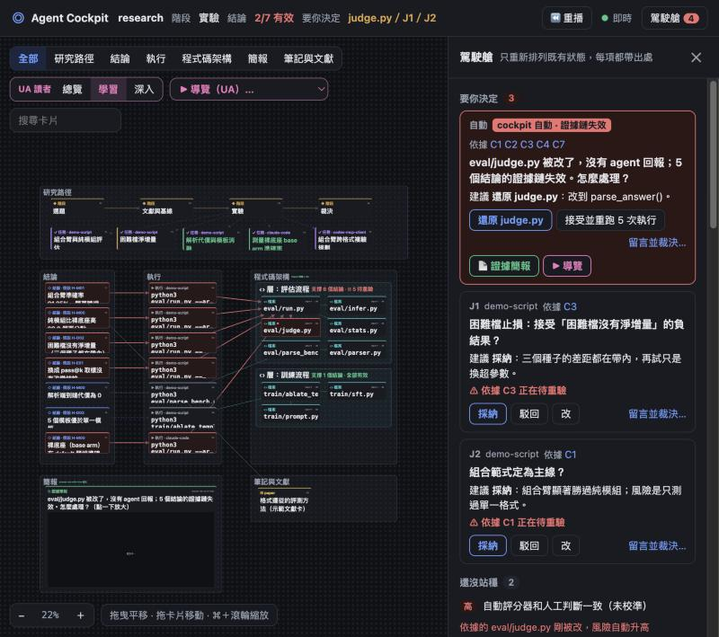

# Agent Cockpit

讓 AI agent 做研究時，**每一個結論都能一路追到產生它的程式碼**。所有 agent（Claude Code、Codex、Cursor、Gemini CLI…）透過 MCP 把研究畫到同一張白板上；一個確定性引擎持續檢查整條證據鏈，任何一環被改，相關的卡片立刻變紅。人不必讀程式碼，看白板就知道哪些結論還能信、為什麼。



偷改評分器之後（沒有 agent 回報），用到它的結論全部變成「待重驗」，紅線從 `judge.py` 一路連到結論，駕駛艙自動送出裁決：



## 快速開始

需要 Node.js 22.13 以上（用到內建的 `node:sqlite`）、git、python3（示範專案用）。

```bash
npm install
npm run demo                                        # 產生示範研究專案，真的跑 6 次實驗、登記 6 個結論
node bin/cockpit.mjs serve --repo demo/research     # 開白板：http://127.0.0.1:4180
node bin/cockpit.mjs demo --break                   # 另開終端機：偷改評分器，看白板即時變紅
node bin/cockpit.mjs demo --restore                 # 改回來，結論恢復有效
npm test                                            # 27 個測試
```

重新產生示範專案（`npm run demo -- --fresh`）前，請先停掉正在跑的 `serve`。

## 用在自己的研究專案

```bash
node /path/to/agent-cockpit/bin/cockpit.mjs init --repo /path/to/research   # 寫好 MCP 設定、AGENTS.md、Stop hook、pre-commit
node /path/to/agent-cockpit/bin/cockpit.mjs serve --repo /path/to/research
```

`init` 只寫在研究專案資料夾裡：`.mcp.json`（Claude Code）、`.cursor/mcp.json`、`.gemini/settings.json`、`.vscode/mcp.json`、`AGENTS.md`、`CLAUDE.md`、`.claude/settings.json`（Stop hook）、`.git/hooks/pre-commit`。Codex 的設定在家目錄，`init` 只印出指令，不會幫你改。

跑實驗一律透過 `cockpit run`（或 MCP 的 `cockpit_run`），結論才有證據可以引用：

```bash
cockpit run -- python3 eval/run.py --arm combo --seeds 1,2
```

## 運作方式

```
主張層   結論 C1「組合臂準確率 91.25%」          ← research-cockpit（主張、假設、前提、裁決）
  │ 數字來自（細到 JSON 欄位）
執行層   R1  python3 eval/run.py --arm combo     ← cockpit run（命令、commit、程式碼與設定的雜湊、輸出檔）
  │ 執行時用到
程式碼層 run.py → infer.py、judge.py、stats.py   ← graphify 的 graph.json，或內建的 import 掃描
  │ 屬於
架構層   「評估流程」                            ← Understand-Anything 的 layers／md² 架構圖／資料夾
註記：open-code-review 的審查結果、UA 的白話摘要與導覽、answer-me-with-html 的證據簡報
```

- **判斷靠內容雜湊**：執行記下它用到的每個檔案的雜湊；之後任何一個不一樣，那次執行就過期，引用它的結論變成「待重驗」。改回原樣，雜湊對上就恢復。全部是確定性規則，0 token。
- **事件是唯一的真相**：`.cockpit/events.jsonl`（進 git，就是 AI 協作紀錄）。`cockpit.db` 的 `canvas_*` 表是給其他工具讀的投影。
- **只有一個寫入咽喉**（`src/gate.mjs`）：MCP、`cockpit run`、白板上的操作都經過它；結論的證據必須是某次執行真的寫出的檔案。

## MCP 工具

| 研究工具 | 用途 |
|---|---|
| `cockpit_overview` | 開工先呼叫：要人決定的事、待重驗的結論與原因、未回報的變更 |
| `cockpit_plan`／`cockpit_stage` | 研究路徑；階段的必要工具沒呼叫過不能結束 |
| `cockpit_task` | agent 自己建、自己更新任務卡 |
| `cockpit_run` | 執行實驗並記錄 |
| `cockpit_claim` | 登記結論（證據必須是執行寫出的檔案與欄位） |
| `cockpit_hypothesis`／`cockpit_premise` | 假設與還沒站穩的前提 |
| `cockpit_decide`／`cockpit_decisions` | 請人裁決、取回裁決 |
| `cockpit_report` | 回報改了哪些檔案 |
| `cockpit_review` | 程式碼審查（open-code-review，或 Delegation mode） |

畫布工具 `canvas_list`、`canvas_read`、`canvas_search`、`canvas_createNode`、`canvas_link`、`canvas_diagram`（md² 架構圖）、`canvas_structure`（graphify）是通用的畫布操作。

## 專案結構

```
bin/cockpit.mjs      命令列：init / serve / mcp / run / check / status / demo
src/engine.mjs       reduce 與 derive：證據鏈、傳播規則、原地打轉、導覽、簡報草稿
src/gate.mjs         寫入咽喉
src/store.mjs        事件庫與畫布投影
src/run.mjs          cockpit run
src/mcp.mjs          MCP server
src/server.mjs       白板 server（SSE、裁決、簡報）
src/init.mjs         各 agent 的設定
web/board.html       白板
demo/template/       示範研究專案（Python，可真的跑）
mockup/              v0.4 的靜態白板原型
vendor/              answer-me-with-html 的 am CLI（MIT）
test/                node:test
docs/                報告用的截圖、需求文件、實測紀錄
```

完整說明見 [REPORT.md](REPORT.md)。授權 GPL-3.0。
