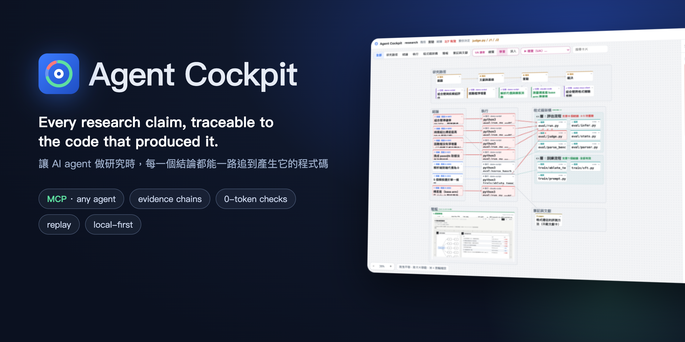
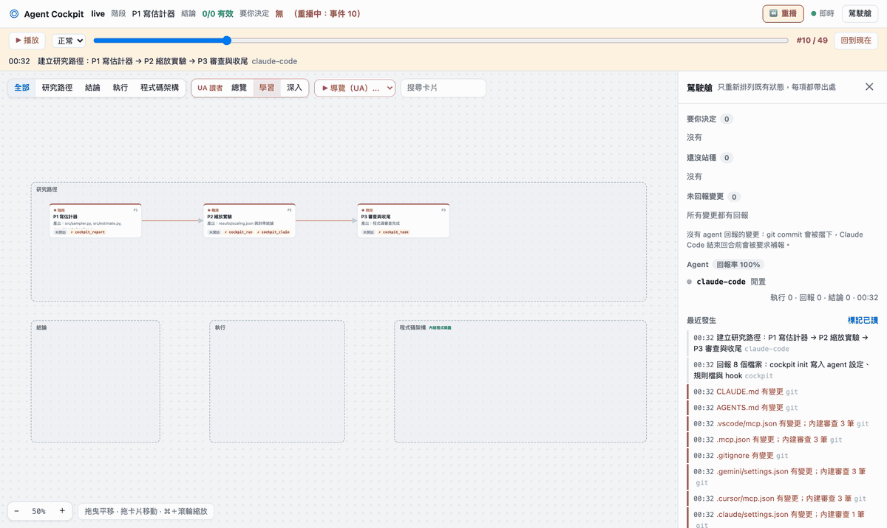
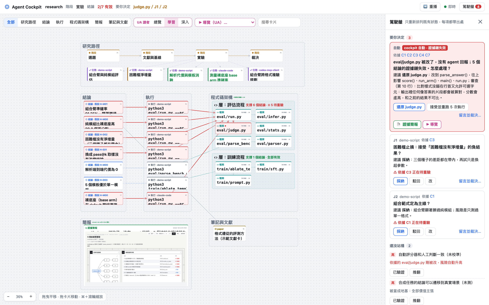
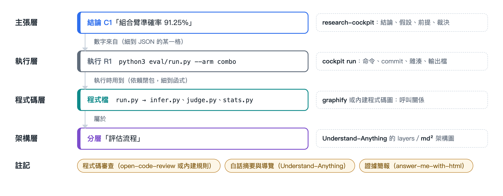
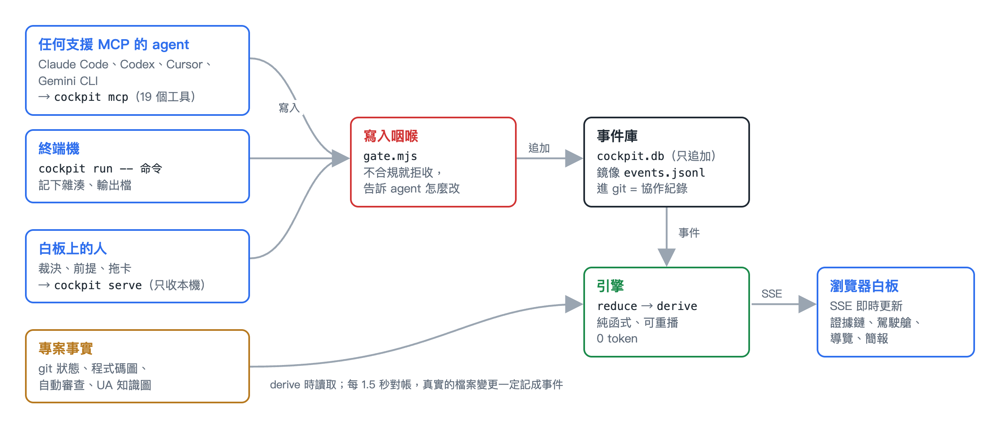

<p align="center"></p>

<p align="center">
  <a href="https://github.com/chutingyean/Agent-Cockpit/actions/workflows/test.yml"></a>
  <a href="LICENSE"></a>
  = 22.13">
  
</p>

<p align="center"><a href="README.md">English</a> · <b>繁體中文</b></p>

**Agent Cockpit** 是給做研究的 AI agent 用的本機白板加上 MCP server。任何支援 MCP 的 agent（Claude Code、Codex、Cursor、Gemini CLI…）都把工作畫到同一張白板上：研究路徑、任務、每一次實驗、每一個結論，以及每次實驗用到的程式碼。一個確定性引擎持續檢查整條證據鏈，任何一環被改，依賴它的卡片立刻變紅。不必讀程式碼，看白板就知道哪些結果還能信、為什麼。

<p align="center"></p>
<p align="center"><sub>重播一次真實的工作過程：Claude Code 和 Codex 從空專案做完一個小研究。有人偷改了程式、沒有回報，一個結論失效，駕駛艙自動送出裁決並產生簡報；人選了「還原」，agent 照做。</sub></p>

## 為什麼需要它

用 AI agent 做研究幾天之後，同樣的問題會一再發生：

- **結論的地基偷偷移動**：agent 改了評分器、資料處理或統計方法，之前「已驗證」的數字其實不再成立，但沒有人發現。
- **對不上帳**：檔案被改了卻沒有 agent 說，或說改了卻沒改。
- **裁決積壓、前提硬化、原地打轉**：該人決定的事堆著沒人回，沒驗證過的推論被當成地基，agent 一直換超參數「再試一次」。
- **程式長得比你讀得快。**

Agent Cockpit 把這些變成機器檢查得了的規則，結果畫在同一張白板上。

## 功能

- **證據鏈細到 JSON 欄位**：結論必須引用某次實驗真的寫出的數值。每次執行都記下腳本、它依賴的每個檔案、以及它碰得到的每個函式的雜湊。任何一個變了，那次執行就過期，建立在它上面的結論標成「待重驗」；改回原樣，雜湊對上就自動恢復。
- **任何 MCP agent 都能接**：agent 身分從 MCP 握手取得。`cockpit init` 寫好 Claude Code、Cursor、VS Code、Gemini CLI 的設定，並印出 Codex 的指令。
- **只有一個寫入咽喉**：MCP、命令列、白板上的操作全部經過同一個驗證函式；不合規的寫入會被拒收，並告訴 agent 怎麼改。被拒收的也會留紀錄。
- **抓得到沒回報的改動**：不管 agent 有沒有回報，真實的檔案變更都會被偵測到。沒回報的變更會擋下 `git commit`，Claude Code 也要先回報才能結束回合。
- **內建程式碼圖與審查，不必另外安裝**：輕量版的 graphify 呼叫圖提供依賴閉包、社群、核心節點與影響範圍；規則審查在每次檔案變更時自動看改到的行。裝了真的 [graphify](https://github.com/Graphify-Labs/graphify) 或 [open-code-review](https://github.com/alibaba/open-code-review) 會自動改用。
- **人在迴圈裡裁決**：agent 用 `cockpit_decide` 發問並等待。改動讓結論失效時，駕駛艙會自己送出裁決，並產生一頁證據簡報（由 [answer-me-with-html](https://github.com/QingYunA/answer-me-with-html) 排版）。
- **重播**：所有東西都是只追加的事件，白板可以拖回或播放到任何一刻；問題修好之後，當時的簡報仍找得回來。
- **本機、確定性**：白板只綁 127.0.0.1；所有檢查都是規則，不呼叫 LLM，0 token。

## 快速開始

需要 Node.js 22.13 以上（用到內建的 `node:sqlite`）、git；示範專案需要 python3。

```bash
git clone https://github.com/chutingyean/Agent-Cockpit.git
cd Agent-Cockpit
npm install
npm run demo                                       # 產生示範研究專案：真的跑 6 次實驗、登記 6 個結論
node bin/cockpit.mjs serve --repo demo/research    # 打開 http://127.0.0.1:4180
```

另開一個終端機，弄壞一個地方看白板怎麼反應：

```bash
node bin/cockpit.mjs demo --break      # 偷偷把評分器的答案比對改鬆，不回報
node bin/cockpit.mjs demo --restore    # 改回來：雜湊對上，結論恢復
```

<p align="center"></p>

## 用在自己的研究專案

```bash
cd /path/to/your-research                                  # 必須是 git repo
node /path/to/Agent-Cockpit/bin/cockpit.mjs init           # MCP 設定、AGENTS.md、Stop hook、pre-commit
node /path/to/Agent-Cockpit/bin/cockpit.mjs serve          # 白板
node /path/to/Agent-Cockpit/bin/cockpit.mjs run -- python3 train.py --lr 1e-3   # 實驗一律透過 cockpit 跑
```

`init` 只會寫在你的專案資料夾裡。用 agent 打開專案，它就會讀到 `AGENTS.md` 和 MCP 設定。各家 agent 的接法見[教學](docs/tutorial.zh-TW.md)。

## 運作方式

<p align="center"></p>

- **看內容雜湊，不看時間戳記**：過期與否靠比對雜湊，所以把檔案改回去就會精確地恢復。
- **函式層級**：Python 依賴檔裡，只改到這次執行碰不到的函式不算過期；改到碰得到的函式、import 或模組層程式碼一律算。
- **事件溯源**：`.cockpit/events.jsonl` 是唯一的真相，同時就是 agent 的工作紀錄（請 commit 它）。白板是純函式的投影（`reduce` → `derive`），所以能重播。

<p align="center"></p>

## MCP 工具

| 研究工具 | 用途 |
|---|---|
| `cockpit_overview` | 開工先呼叫：要人決定的事、待重驗的結論與原因、沒回報的變更 |
| `cockpit_plan`／`cockpit_stage` | 研究路徑；階段的必要工具沒呼叫過不能結束 |
| `cockpit_task` | agent 自己的任務卡，每一輪更新（做了什麼、為什麼、下一步） |
| `cockpit_run` | 執行實驗並記錄 |
| `cockpit_claim` | 登記結論；證據必須是某次執行寫出的檔案與欄位 |
| `cockpit_hypothesis`／`cockpit_premise` | 假設與還沒驗證的前提 |
| `cockpit_decide`／`cockpit_decisions` | 請人裁決、取回裁決 |
| `cockpit_report` | 回報改了哪些檔案 |
| `cockpit_review` | 程式碼審查：有 ocr 跑 ocr，沒有用內建規則；也可以回報自己的審查結果 |

畫布工具：`canvas_list`、`canvas_read`、`canvas_search`、`canvas_createNode`、`canvas_link`、`canvas_diagram`（[md²](https://github.com/jan-bogaerts/md2) 格式的架構圖）、`canvas_structure`（程式碼圖與影響範圍）。

## 命令列

在這個 repo 執行一次 `npm link` 就有全域的 `cockpit` 指令；否則用 `node bin/cockpit.mjs`。

| 指令 | 用途 |
|---|---|
| `cockpit init` | 寫好 MCP 設定、規則檔、Stop hook 與 pre-commit |
| `cockpit serve [--port 4180]` | 開白板 |
| `cockpit run -- <命令>` | 執行並記錄實驗 |
| `cockpit graph` | 重建程式碼圖（有 graphify 用 graphify） |
| `cockpit review [--all]` | 程式碼審查（有 ocr 用 ocr；預設只看改到的行） |
| `cockpit status`／`cockpit check` | 印出駕駛艙摘要／列出沒回報的變更 |
| `cockpit demo [--break\|--restore\|--fresh]` | 示範專案 |

所有指令都可以加 `--repo <路徑>`，預設是目前資料夾。

## 專案結構

```
bin/cockpit.mjs      命令列
src/engine.mjs       reduce 與 derive：證據鏈、傳播規則、導覽、簡報草稿
src/gate.mjs         寫入咽喉
src/store.mjs        事件庫（node:sqlite）與畫布投影
src/run.mjs          cockpit run
src/graph.mjs        內建程式碼圖（輸出與 graphify 相容）
src/review.mjs       內建規則審查
src/mcp.mjs          MCP server
src/server.mjs       白板 server（SSE、裁決、簡報、重播）
web/board.html       白板（不用框架、不用打包）
demo/template/       示範研究專案（Python，可真的跑）
docs/                教學、圖、截圖、一次真實工作過程的紀錄
test/                node:test（npm test）
```

## 文件

- [教學](docs/tutorial.zh-TW.md)：從示範專案到自己的專案、各家 agent 的接法、重播，以及一次真實工作過程的紀錄
- [真實工作紀錄](docs/live-run/)：事件、agent 寫的程式、agent 的輸出

## 致謝

Agent Cockpit 把六個專案的想法融合成同一張證據圖：
[research-cockpit](https://github.com/sanngotall/research-cockpit)（結論、假設、前提、裁決）、
[graphify](https://github.com/Graphify-Labs/graphify)（程式碼圖）、
[open-code-review](https://github.com/alibaba/open-code-review)（程式碼審查）、
[Understand-Anything](https://github.com/Egonex-AI/Understand-Anything)（白話摘要、分層、導覽、讀者模式）、
[md²](https://github.com/jan-bogaerts/md2)（架構圖格式）、
[answer-me-with-html](https://github.com/QingYunA/answer-me-with-html)（一頁簡報）。
哪些東西附在 repo 裡、各是什麼授權，見 [THIRD_PARTY_NOTICES.md](THIRD_PARTY_NOTICES.md)。

## 授權

Copyright (C) 2026 chutingyean

Agent Cockpit 是自由軟體：你可以依照自由軟體基金會發布的 [GNU Affero 通用公共授權條款](LICENSE)第 3 版，或（依你的選擇）任何更新的版本，重新散布或修改它。如果你修改後透過網路讓別人使用，必須提供你那個版本的原始碼。第三方元件維持各自的授權，見 [THIRD_PARTY_NOTICES.md](THIRD_PARTY_NOTICES.md)。
