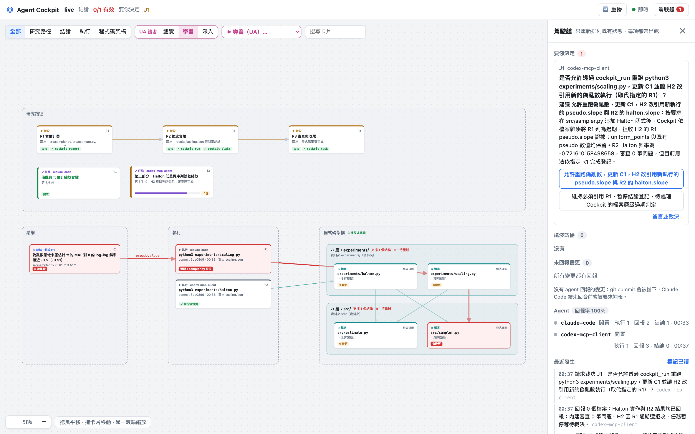
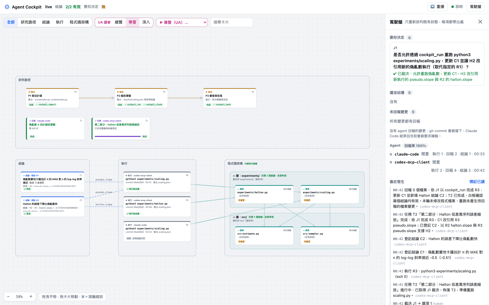
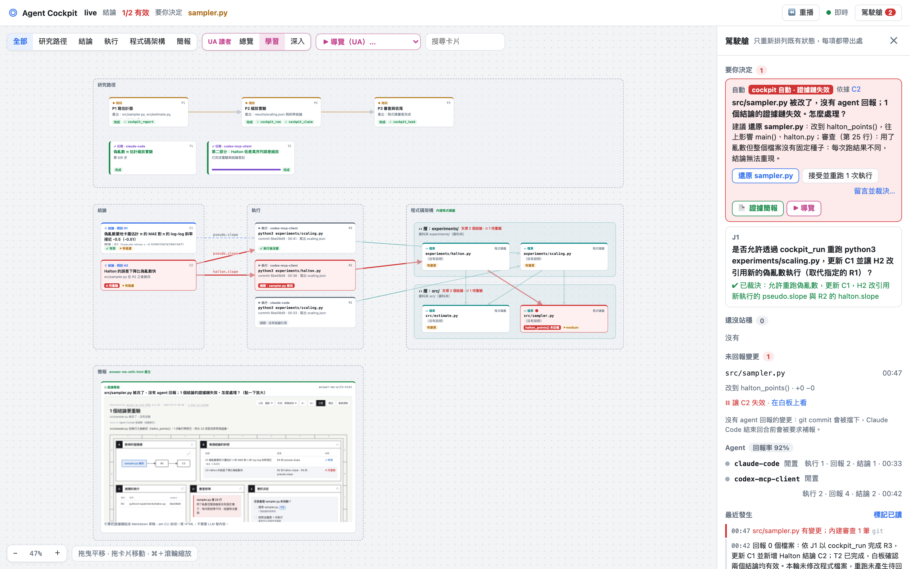
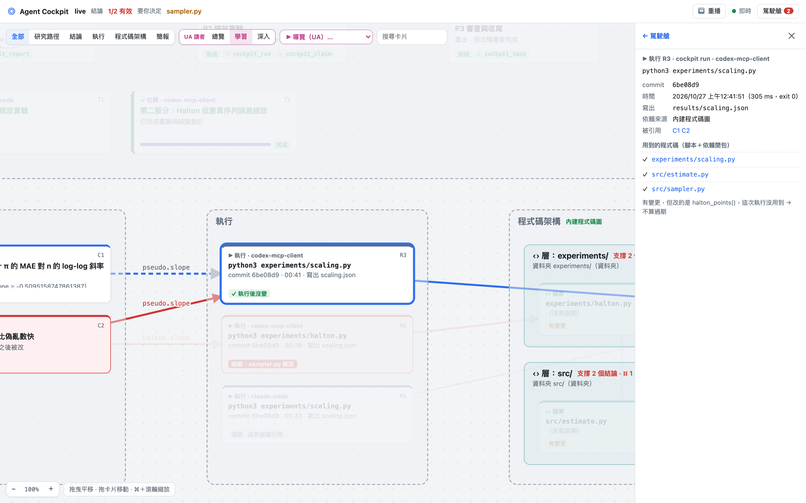
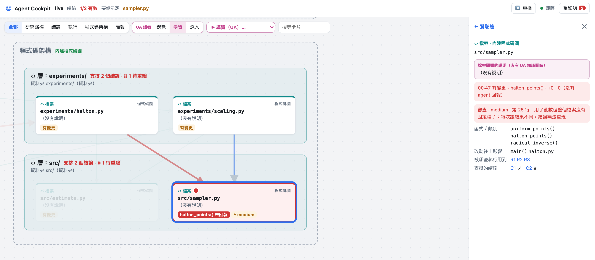
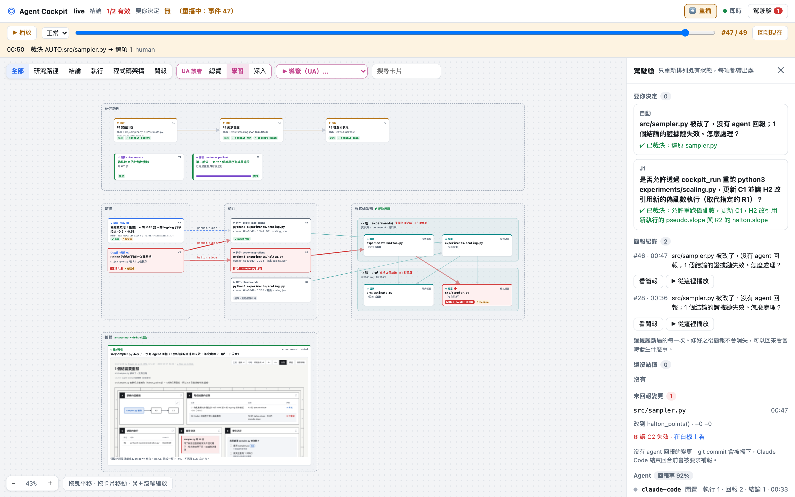

# Agent Cockpit tutorial

**English** · [繁體中文](tutorial.zh-TW.md)

This tutorial starts with the demo project so you can learn to read the board, then connects Agent Cockpit to your own research repo and puts Claude Code, Codex and other agents to work under its rules. It ends with a recorded real session in which two agents complete a small study from an empty repo.

- [1. Install](#1-install)
- [2. A five-minute tour](#2-a-five-minute-tour)
- [3. Your own research repo](#3-your-own-research-repo)
- [4. Connect your agents](#4-connect-your-agents)
- [5. Built-in code graph and code review](#5-built-in-code-graph-and-code-review)
- [6. Decisions, briefs and replay](#6-decisions-briefs-and-replay)
- [7. FAQ](#7-faq)
- [8. Case study: two agents, one empty repo](#8-case-study-two-agents-one-empty-repo)

---

## 1. Install

| Software | Version | Used for |
|---|---|---|
| Node.js | 22.13 or later (24 recommended) | Agent Cockpit itself (uses the built-in `node:sqlite`) |
| git | any | Detecting file changes, the pre-commit check |
| python3 | 3.9 or later | Only the demo project |
| An MCP-capable agent | Claude Code, Codex, Cursor, Gemini CLI, … | Doing the research |

You do not need graphify or open-code-review: Agent Cockpit ships lightweight built-in versions and switches to the real tools when they are installed.

```bash
git clone https://github.com/chutingyean/Agent-Cockpit.git
cd Agent-Cockpit
npm install
npm test        # about 4 seconds
npm link        # optional: makes the `cockpit` command available everywhere
```

The rest of this tutorial writes `cockpit`. Without `npm link`, use `node /path/to/Agent-Cockpit/bin/cockpit.mjs` instead.

## 2. A five-minute tour

```bash
npm run demo                              # builds demo/research: 6 real experiment runs, 6 claims
cockpit serve --repo demo/research        # open http://127.0.0.1:4180
```

Read the board from left to right; together the regions form one evidence chain:

| Region | Contents | How to read it |
|---|---|---|
| Research path | Stage cards and task cards | Agents create and update their own cards, including *why* and *next* |
| Claims | Every claim and its number | Green ✓ valid; red ⛓ needs recheck |
| Runs | Every `cockpit run` | Command, commit, files written; marked *stale* once something it used changes |
| Code architecture | The code files the runs used, grouped into layers | *Core* marks the most-connected file; click a file for its functions, impact and review findings |
| Brief | A one-page evidence brief for the latest broken chain | What broke, which claims are affected, what to do |
| Notes & papers | General cards agents created | |

The panel on the right is the **cockpit**: decisions waiting for you, premises that are not yet verified, unreported changes, what each agent is doing, the brief history and a timeline.

The three reader modes at the top change how much detail cards show: **Overview** (for non-programmers), **Learning** (with short explanations) and **Deep** (actual values, hashes, function names).

### Break something

In a second terminal:

```bash
cockpit demo --break --repo demo/research      # quietly loosens the grader's answer matching; no agent reports it
```

Within about 1.5 seconds the board shows:

1. `eval/judge.py` turns red, and its card says `parse_answer()` was changed.
2. A red line runs from `judge.py` through every run that used it (R1–R4) to their claims (C1–C4), which now need recheck.
3. The built-in reviewer has looked at the changed line and flags it as **high**: the pattern is no longer anchored to the start of a line and accepts optional characters, so scores will be inflated.
4. The code graph computes the impact: `parse_answer()` → `score()` → `run_arm()` → `main()`.
5. The cockpit raises a decision: "judge.py changed and nobody reported it; 4 claims lost their evidence. Restore it, or accept the change and re-run?" The brief lays this out on one page.

```bash
cockpit demo --restore --repo demo/research    # put it back: hashes match, every claim recovers
```

> Stop `serve` before regenerating the demo with `npm run demo -- --fresh`.

## 3. Your own research repo

### 3.1 Initialize

```bash
cd /path/to/your-research          # must be a git repo
cockpit init
```

`init` only writes inside your repo:

| File | For |
|---|---|
| `.mcp.json` | Claude Code |
| `.cursor/mcp.json` | Cursor |
| `.vscode/mcp.json` | VS Code (Copilot) |
| `.gemini/settings.json` | Gemini CLI |
| `AGENTS.md`, `CLAUDE.md` | The rules every agent reads |
| `.claude/settings.json` | Claude Code's Stop hook: no ending a turn with unreported changes |
| `.git/hooks/pre-commit` | No committing unreported changes |

Codex keeps its config in your home directory, so `init` only prints the command (see 4.2).

### 3.2 Open the board

```bash
cockpit serve                      # http://127.0.0.1:4180
```

The board binds to 127.0.0.1 only and is not reachable from other machines.

### 3.3 Run every experiment through the cockpit

```bash
cockpit run -- python3 experiments/train.py --lr 0.001
```

`cockpit run` records:

- the command and the commit;
- the hash of the script and of every file it imports, directly or indirectly;
- for Python dependencies, the hash of each function and the set of functions this run can reach;
- the hashes of config files;
- which files the run wrote, and the hash of every field in JSON results.

If anything the run used later changes, the run becomes **stale** and every claim citing it needs **recheck**. Changes to functions the run never reaches do not count. A number that did not come from `cockpit run` cannot be registered as a claim.

## 4. Connect your agents

### 4.1 Claude Code

Open Claude Code in your research repo. It picks up `.mcp.json` and `CLAUDE.md` and asks once whether to enable the `cockpit` MCP server.

Headless, for scripts:

```bash
claude -p "Follow the rules in AGENTS.md. Task: ..." \
  --mcp-config .mcp.json --strict-mcp-config \
  --allowedTools "mcp__cockpit,Read,Write,Edit" --max-turns 40
```

Leaving out Bash is deliberate: the agent can only run code through `cockpit_run`, so every run is recorded.

### 4.2 Codex

```bash
codex mcp add cockpit -- node /path/to/Agent-Cockpit/bin/cockpit.mjs mcp --repo "$PWD"
```

`codex exec` (headless) does not allow MCP tool calls by default. Without touching your global config, pass the server on the command line:

```bash
codex exec \
  -c 'mcp_servers.cockpit.command="node"' \
  -c "mcp_servers.cockpit.args=[\"/path/to/Agent-Cockpit/bin/cockpit.mjs\",\"mcp\",\"--repo\",\"$PWD\"]" \
  -c 'mcp_servers.cockpit.default_tools_approval_mode="approve"' \
  --sandbox workspace-write "Follow the rules in AGENTS.md. Task: ..."
```

### 4.3 Cursor, Gemini CLI, VS Code

`init` has already written their config files; just open the repo. Gemini CLI reads `AGENTS.md` through `.gemini/settings.json`.

### 4.4 What agents are required to do

The seven rules in `AGENTS.md`, enforced by the write gate:

1. Start every session with `cockpit_overview`.
2. Create a task card with `cockpit_task` and update it every round (what, why, next).
3. Run every experiment with `cockpit_run`.
4. Register claims with `cockpit_claim`. Evidence must point to a file and field written by a recorded run, and a stale run is rejected.
5. Report changed files with `cockpit_report`. Unreported changes turn red on the board, block `git commit`, and stop Claude Code from ending its turn.
6. Ask a human with `cockpit_decide`; read the answers with `cockpit_decisions`.
7. Record unverified premises with `cockpit_premise`.

A non-compliant call is rejected with the reason, for example "the evidence results/x.json was not written by R3". Agents usually fix it and retry on their own. The board counts how many times each agent was rejected.

## 5. Built-in code graph and code review

### 5.1 Code graph (lightweight graphify)

```bash
cockpit graph
```

- Extracts functions, classes, imports and calls from Python and JS/TS, and writes `.cockpit/graph/graph.json` in graphify's node-link format.
- `.cockpit/graph/GRAPH_REPORT.md` lists core nodes (most-connected functions), communities (functions that call each other), surprising links (calls across communities and files) and suggested questions.
- Dependency closures for `cockpit run` and the layers on the board come from this graph.
- When a file changes, the board and the auto-decision show the **impact**: which functions call the changed ones, directly or indirectly. Agents can ask too: `canvas_structure({ file: "src/estimate.py", funcs: ["estimate_pi()"] })`.
- If `graphify-out/graph.json` exists (from the real graphify: tree-sitter, 40 languages), it is used instead.

### 5.2 Code review (lightweight open-code-review)

```bash
cockpit review          # only the lines changed in this diff, like ocr
cockpit review --all    # the whole project
```

The rules target what goes wrong in research code:

| Rule | Severity | Why it threatens a claim |
|---|---|---|
| Loosened scoring match (unanchored pattern with optional characters) | high in grading code | Inflated scores, not comparable with earlier results |
| Training code reads test data | high | Data leakage |
| Randomness without a fixed seed | medium | Results cannot be reproduced |
| Swallowed exceptions (`except: pass`) | medium | Failed samples are skipped silently and the denominator changes |
| Mutable default arguments | medium | One call's results leak into the next |
| `eval`/`exec`, `shell=True`, SQL string building, `pickle` | high / medium | Security |
| Hard-coded absolute paths, TODOs | low | Breaks on another machine; unfinished work |

Findings travel up the evidence chain: claims built on a flagged file are marked *questioned*. Every time a file change is detected, the cockpit also reviews the changed lines automatically, at no token cost, and the finding disappears once the file is reverted.

With open-code-review (`ocr`) installed, `cockpit review` and `cockpit_review` use it instead. Agents can also review on their own and report with `cockpit_review({ findings: [...] })`.

## 6. Decisions, briefs and replay

- **Decisions.** An agent's `cockpit_decide` question shows up in the cockpit with its options and a recommendation. Click an option, optionally with a comment. The agent reads the answer with `cockpit_decisions`. A task with a pending blocking decision cannot be closed.
- **Automatic decisions.** When an unreported change breaks claims, the cockpit raises a decision on its own ("restore, or accept and re-run"). It does the same when a script is re-run three or more times with only config changes (a "dead-end loop").
- **Briefs.** Each broken chain gets a one-page brief: the broken chain as a diagram, every claim's status, stale runs, review findings, and the decision. The engine assembles the content from the evidence graph and answer-me-with-html lays it out; no LLM writes it.
- **Replay.** Click **⏪ Replay** at the top right. Drag the slider to any event, or press **▶ Play** to watch the research unfold step by step (slow / normal / fast). The bar shows what each event was. When playback reaches a broken chain, the brief appears in view. When it ends, the board returns to the present. The state during replay is derived entirely from events, so a break that was fixed long ago still shows exactly as it was.
- **Brief history.** The cockpit lists every time the evidence chain broke. *View brief* opens the brief as it was at that moment; *▶ Play from here* replays that stretch.

## 7. FAQ

**A claim on the board turned red. What now?** Click it to see why (for example "src/estimate.py changed after R1"). If the change is intended, re-run the experiment and register the claim again. If it was a mistake, revert the file; once the hashes match, the claim recovers by itself.

**I edited a file by hand. Do I have to report it?** Yes. Ask your agent to call `cockpit_report`, or answer the automatic decision on the board. Otherwise the pre-commit hook blocks `git commit`.

**Where are the events stored?** In `.cockpit/events.jsonl`, a text file you should commit; it is the complete work log. `.cockpit/cockpit.db` (SQLite) is not committed and is rebuilt from the jsonl file if deleted.

**Does anything leave my machine?** No. The board binds to 127.0.0.1, and every check is a local deterministic rule with no LLM calls.

**Which languages are supported?** The built-in code graph and function-level staleness cover Python, and the code graph also covers JS/TS. Other languages fall back to whole-file hashing, or install graphify for 40 languages.

## 8. Case study: two agents, one empty repo

This is a recorded real session, not seeded demo data. The full event log is in [live-run/events.jsonl](live-run/events.jsonl), the code the agents wrote is in [live-run/project/](live-run/project/), and their output is in `live-run/*.log`. Times are local.

### 8.1 Starting point

A git repo containing only a `README.md` with the research question, after `cockpit init`:

> Estimate π by sampling uniform points in the unit square. Does the error fall as n^(-1/2)? Is a low-discrepancy sequence (Halton) faster? Python standard library only; every experiment must be reproducible.

### 8.2 Claude Code does part one (00:32–00:33)

Run headless with only the cockpit MCP tools and Read/Write/Edit, and no Bash, so it can only run code through `cockpit_run`. On its own it:

1. planned three stages and created task card T1, updating it after every step;
2. wrote `src/sampler.py`, `src/estimate.py` and `experiments/scaling.py`;
3. ran R1 through `cockpit_run`: the mean absolute error went 0.122 → 0.0233 → 0.00978 → 0.00326, a log-log slope of **−0.5095**;
4. registered claim C1, citing `pseudo.slope` in `results/scaling.json` written by R1, ran the built-in review (0 findings) and closed the stages.

Its first `cockpit_report` was rejected by the gate because the *why* was too short; it rewrote it and resubmitted.

### 8.3 Codex does part two, gets blocked, and asks a human (00:35–00:37)

Codex added `halton_points()` to `src/sampler.py`, wrote `experiments/halton.py` and ran R2: Halton slope **−0.7216**.

When it tried to register "Halton is faster than pseudo-random", citing R1's `pseudo.slope`, **the gate rejected the claim**: `src/sampler.py` had changed after R1, so R1 was stale. Codex did not force it through. It marked its task *blocked* and sent decision J1: "May I re-run the pseudo-random experiment and update C1?"



### 8.4 What the session taught us: function-level staleness

Codex had only **added** a function; `uniform_points()` was untouched and R1's number was still right. "Any change to a dependency makes the run stale" was too conservative here.

So the code graph now feeds the evidence chain. `cockpit run` records the hash of every function in its Python dependencies and which functions the run can reach (following calls from the script). If a later change touches only unreachable functions and leaves module-level code alone, the run stays valid. Changes to reachable functions, imports or top-level code still make it stale; the rule prefers a false alarm to a missed one.

### 8.5 A human decides, the agent follows (00:41–00:42)

On the board, J1 was answered "allow the re-run". Codex picked it up: read `cockpit_decisions` → re-ran the pseudo-random experiment (R3) → updated C1 → registered C2, citing R2's `halton.slope` and R3's `pseudo.slope` → closed its task. Both claims are valid.



### 8.6 An unreported change (00:47)

Simulating an agent that slips in an "optimization", random jitter was added inside `halton_points()` and not reported. Within 1.5 seconds:

- **Only C2 needs recheck; C1 stays valid.** The same file changed, but R3 (C1's evidence) never reaches `halton_points()`. This is the function-level rule from 8.4 at work.
- The built-in review flagged **line 25: randomness without a fixed seed, so results cannot be reproduced**.
- The automatic decision states the impact ("changed `halton_points()`, which affects `main()` in `halton.py`") and recommends restoring the file.



| Run R3: sampler.py changed, but not a function R3 uses | sampler.py: review finding, functions, impact |
|---|---|
|  |  |

### 8.7 A human chooses restore, Claude Code carries it out (00:50)

On the board, the decision was answered "restore sampler.py". Claude Code read the decision, removed the jitter with Edit (the result matches the original byte for byte) and reported it. The hashes matched, C2 recovered, and the report rate returned to 100%.

### 8.8 Watch it again

Afterwards, click **⏪ Replay** → **▶ Play** to watch both agents work from the first event. At 00:47, C2 turns red and the brief appears.



One gap the session exposed is still open: decisions have no *done* state. At the end, Claude Code asked whether it should carry out J1, which Codex had already done in 8.5.
